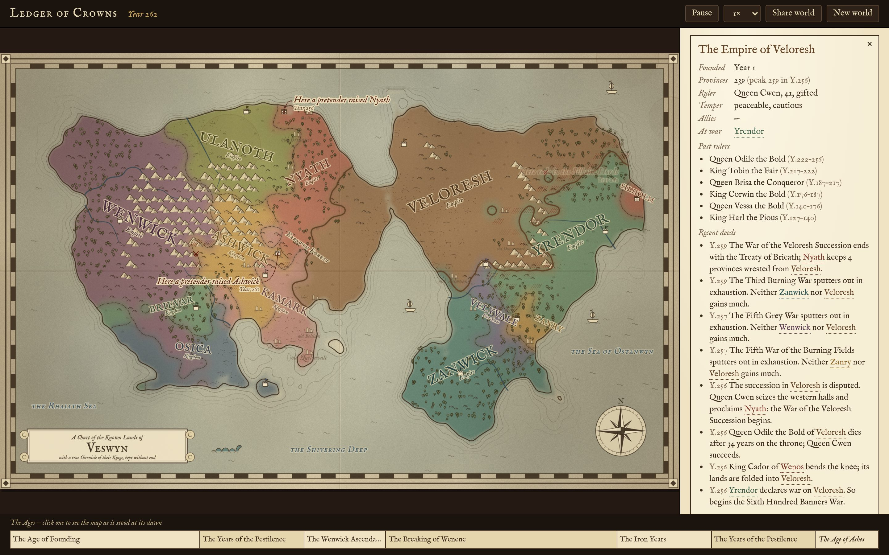

# Ledger of Crowns

A history that writes itself. Realms rise, wage war, swear pacts, betray their allies, rebel, split over disputed successions, suffer plague and nomad invasions, and fall. All of it plays out on a hand-inked fantasy map, while a chronicle records each reign and war by name.

There is no player. You watch, follow a realm you care about, and come back later to find out what happened.

## Running it

Open `index.html` in a browser. There is no build step and nothing to install. The page loads two typefaces from Google Fonts and falls back to Georgia when offline.

- **Follow a realm:** click it on the map or its name in the chronicle.
- **Zoom and move:** scroll or pinch to zoom up to 4×, drag to move, and double-click to zoom in. The buttons in the corner and the + − 0 and arrow keys do the same. Names stay sharp and more of them appear as you zoom in.
- **Look back:** click an age on the timeline to see the map as it stood when that age began.
- **Share a world:** **Share world** copies a link. Anyone who opens it watches the same world unfold from the same seed. Their own world is set aside, not erased.
- **Seeds:** `index.html?seed=4242` always produces the same world and the same history.

## What it does

**No two worlds share a shape.** Each seed picks a kind of world: a single continent, twin lands divided by a winding strait, a continent wrapped around an inland sea, or an archipelago. Mountains follow ridgelines, so they form ranges instead of blobs. Every sea, lake, mountain range, great forest and desert gets a name. Short dotted sea lanes link separate landmasses, so island realms can be reached and conquered. Ships sail the open water, and the occasional sea serpent lurks there.

**Kingdoms have houses, faiths, governments and treasuries.**
- *Dynasties:* every crown belongs to a named house with its own coat of arms. Neighbouring crowns marry. When a royal line dies out, a realm can pass by marriage to another kingdom, joining two crowns under one ruler, or the claim starts a succession war.
- *Faiths:* faiths spread province by province. Provinces of another faith are restless and rebel along religious lines. Priests preach holy wars, rulers convert to the faith of their people, and a faith that grows too large splits in a Great Schism. The **Faiths** button redraws the map by belief.
- *Kinds of rule:* kingdoms, merchant republics that elect a Doge every decade or so, and theocracies ruled by a High Priest. Revolutions topple crowns, priests seize power in hard times, and strongmen crown themselves.
- *Wealth:* towns and roads fill the treasury, and armies empty it. Gold hires mercenaries. A realm pays to run its lands and to keep its armies in the field, so long wars with big armies can end in bankruptcy and deserting soldiers, and long peace in a golden age that glows around the capital.

**Big events stop the clock.** When a great realm falls, a capital is sacked, a horde arrives or a new age begins, time slows to a crawl. The map darkens around the place, ink rings ripple out from it, and a title banner such as "The Fall of Asharene" writes itself across the map. Only one plays at a time, and the most important event wins.

**The map remembers.** Villages are founded in fertile land at peace and every realm's seat is a settlement. Each one is a planned town, drawn the way old maps draw towns, on a plan that suits its site. Coastal towns build a grid squared to the shore with a jetty into the water; river towns run a long main street along the river; some seats of power are radial, with rings of houses, radiating streets and a star-shaped wall; and other towns use a grid. A grid town has its own street grid of square blocks around a market square, with a temple facing the square (and a palace in a great city). Houses with pitched roofs line every block, three to a side, in the town's own roofing. A town grows along its two main streets first, then fills the quarters between, block by block. When it becomes a city it walls in the blocks it holds, with towers at the corners and gatehouses where the main streets leave; harbour sides stay open to the sea. Strip fields on the same grid surround it, nearest first, and turn richer in a golden age. Fields are laid out on a shared land register: houses claim their ground first, then the largest town plants first. Fields never overlap another town's fields or houses, never go on the sea or on mountains, and stop at the realm's border. Growth compounds, so a rich city draws people faster than a village does, up to a ceiling set by trade roads, rivers and harbours, golden ages and merchant rule. Ordinary towns top out as great cities, but the seat of a large, rich realm can become a metropolis of several hundred buildings with a second ring of walls round its suburbs. A neighbouring city nearby lowers that ceiling, so cities don't grow into each other. Zoomed out, a full city block is drawn as one solid built-up block, and the map moves its last drawn picture while you drag, so panning stays smooth however large the cities get. War, plague, famine and bankruptcy shrink it, and abandoned districts stay on the map as empty outlines. A settlement is put to the torch when its province falls. Roads join each realm's towns to its capital and cross borders only between allies. They are cut where fighting is fresh, and an old road fades slowly after it falls out of use. The bloodiest ground of each great war is marked with crossed swords and the battle's name, and stays on the map for a century and a half.

**Wars are fought over demands and end in treaties.** Every war has a goal: a border region to seize, lost lands to win back, the faithful of another realm to free, tribute, a disputed throne, or, for rebels, independence. Each side calls its allies to the banners, and both sides raise armies from their manpower. Armies march province by province and fight pitched battles when they meet. Each army's sprite grows with its strength, shows its numbers, and floats up its casualties while it fights. An army in enemy land besieges the province it stands on and occupies it; occupied provinces are striped in the occupier's colour and pay no taxes. A realm that is invaded or outnumbered hunts the invaders first, then frees its occupied land, then holds its capital.

A hidden war score (from -100 to 100) weighs what each side occupies, who is winning the battles and how long the attacker has held its goal. War weariness grows with the years, the dead, occupied land and empty treasuries. Each year the leaders weigh the two. When the loser has had enough, the winner makes demands worth up to its war score: provinces it actually holds (the war's goal first, never the capital), freeing the faithful of a holy war as a new realm, and tribute in gold for ten years. Only a small realm that is beaten and overrun can be annexed whole. Stalemates end in a white peace. The treaty is written into the chronicle with its terms, and a hard peace gets a big moment. Harsh treaties earn infamy, which turns neighbours against the victor. Hordes alone do not negotiate: they keep what they take. Followed realms show whether they are winning or losing each war.

**The map is drawn, not tiled.** Each world is generated from a seed. Fractal noise makes the terrain. The coastline and the offshore ripple lines are traced from the height map with marching squares. Mountains, hills, forests and dunes are drawn as ink symbols, and rivers run downhill to the sea. Each realm's territory is a smooth field rather than a set of hexes: its watercolour wash and its dash-dot border are contours of that field, so borders curve the way a cartographer would draw them.

**The simulation resists stagnation.** Most self-running strategy simulations settle into one empire covering the map within minutes. Here, power falls off sharply as a realm grows. Provinces far from the capital grow restless and revolt, more often in any realm holding over 30% of the land. Successions can split a realm in two, rivals form coalitions against whoever is largest, and plague and hordes hit the biggest realms hardest. Small realms bend the knee to large neighbours, so the map holds around 10 to 20 realms at a time. Across test runs of 600 years, the largest realm peaked at 30% to 40% of the land and then broke apart.

**Only what matters reaches the chronicle.** Every event is recorded in the history of the realms involved. The main chronicle keeps only events touching realms that hold a meaningful share of the land. The biggest moments (a sacked capital, a betrayal, the fall of an empire) are also written onto the map beside where they happened, and fade over ten years.

**It keeps time while you're away.** The world saves to the browser every few seconds. Reopening the page resumes it exactly: the random number generator's state is saved too, so a resumed world produces the same history as one that never stopped. Up to 200 years that passed while the page was closed are played out on the map a slice at a time, with a progress bar, so the page stays responsive; then they are summarised. Closing the page mid-way keeps the remaining years owed.

## Pacing

At 1× speed a game year takes four seconds. A realm's rise and fall usually spans 60 to 120 years, which is four to eight minutes. A speed control runs from ½× to 16×. A new world plays its first 40 years at 16×, about ten seconds, so you watch the first realms spread across empty land before history settles to normal speed.

## How it's built

Everything is in one file, `index.html`: about 1,500 lines of plain JavaScript and Canvas 2D, with no dependencies. The map is drawn in layers so the page stays cheap to run:

1. **Paper.** Parchment colour, stains, fold creases and grain. Drawn once per world.
2. **Washes.** Watercolour territory. Redrawn only when borders move.
3. **Ink.** Coastlines, terrain symbols, rivers, frame, compass and cartouche. Drawn once per world.
4. **Overlay.** Borders, names, capitals and ruins. Redrawn when something changes.
5. **Live marks.** Armies, battle smoke, fires, plague, ships, fresh conquests and map notes. Animated at about 30 frames a second.

When the world changes, the map redraws only what changed. It compares the world against a snapshot of what it last showed (provinces, towns, roads, battlefields and realm names), repaints just those areas, and falls back to a full redraw if a change can't be confined. A one-province change costs about a fifth of a full redraw, with pixel-identical results. At normal zoom, each town's buildings and fields are drawn once into an image and reused until the town changes, so a full redraw copies images instead of drawing thousands of houses. Zoomed in, towns are drawn directly, because only a few are on screen.

Typefaces: IM Fell English and IM Fell English SC by Igino Marini, under the SIL Open Font License.
