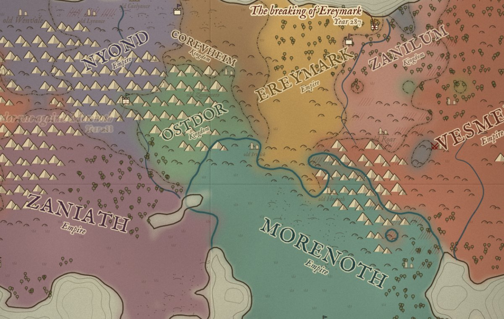
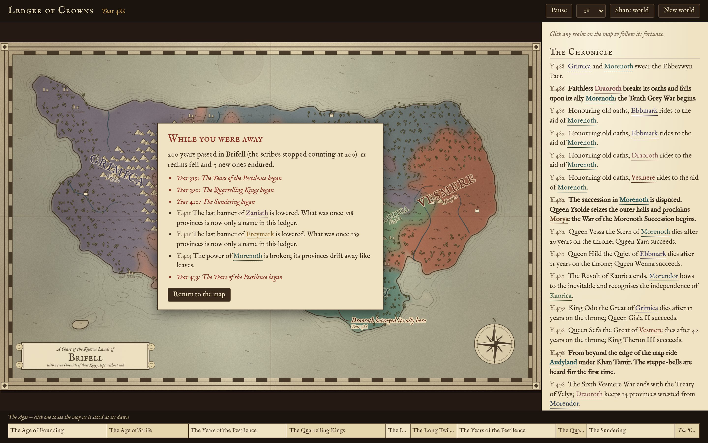

# Ledger of Crowns

A history that writes itself. Realms rise, wage war, swear pacts, betray their allies, rebel, split over disputed successions, suffer plague and nomad invasions, and fall. All of it plays out on a hand-inked fantasy map, while a chronicle records each reign and war by name.

There is no player. You watch, follow a realm you care about, and come back later to find out what happened.

## Running it

Open `index.html` in a browser. There is no build step and nothing to install. The page loads two typefaces from Google Fonts and falls back to Georgia when offline.

- **Follow a realm:** click it on the map or its name in the chronicle.
- **Look back:** click an age on the timeline to see the map as it stood when that age began.
- **Share a world:** **Share world** copies a link. Anyone who opens it watches the same world unfold from the same seed. Their own world is set aside, not erased.
- **Seeds:** `index.html?seed=4242` always produces the same world and the same history.

## What it does

**The map is drawn, not tiled.** Each world is generated from a seed. Fractal noise makes the terrain. The coastline and the offshore ripple lines are traced from the height map with marching squares. Mountains, hills, forests and dunes are drawn as ink symbols, and rivers run downhill to the sea. Each realm's territory is a smooth field rather than a set of hexes: its watercolour wash and its dash-dot border are contours of that field, so borders curve the way a cartographer would draw them.

**The simulation resists stagnation.** Most self-running strategy simulations settle into one empire covering the map within minutes. Here, power falls off sharply as a realm grows. Provinces far from the capital grow restless and revolt, more often in any realm holding over 30% of the land. Successions can split a realm in two, rivals form coalitions against whoever is largest, and plague and hordes hit the biggest realms hardest. Small realms bend the knee to large neighbours, so the map holds around 10 to 20 realms at a time. Across test runs of 600 years, the largest realm peaked at 30% to 40% of the land and then broke apart.

**Only what matters reaches the chronicle.** Every event is recorded in the history of the realms involved. The main chronicle keeps only events touching realms that hold a meaningful share of the land. The biggest moments (a sacked capital, a betrayal, the fall of an empire) are also written onto the map beside where they happened, and fade over ten years.

**It keeps time while you're away.** The world saves to the browser every few seconds. Reopening the page resumes it exactly: the random number generator's state is saved too, so a resumed world produces the same history as one that never stopped. Up to 200 years that passed while the page was closed are replayed in about a second, then summarised.

## Pacing

At 1× speed a game year takes four seconds. A realm's rise and fall usually spans 60 to 120 years, which is four to eight minutes. A speed control runs from ½× to 16×. Each new world opens with its first 40 years already written, so there's something to watch straight away.

## How it's built

Everything is in one file, `index.html`: about 1,500 lines of plain JavaScript and Canvas 2D, with no dependencies. The map is drawn in layers so the page stays cheap to run:

1. **Paper.** Parchment colour, stains, fold creases and grain. Drawn once per world.
2. **Washes.** Watercolour territory. Redrawn only when borders move.
3. **Ink.** Coastlines, terrain symbols, rivers, frame, compass and cartouche. Drawn once per world.
4. **Overlay.** Borders, names, capitals and ruins. Redrawn when something changes.
5. **Live marks.** Front lines, fresh conquests and map notes. Drawn each simulated month.

Typefaces: IM Fell English and IM Fell English SC by Igino Marini, under the SIL Open Font License.
